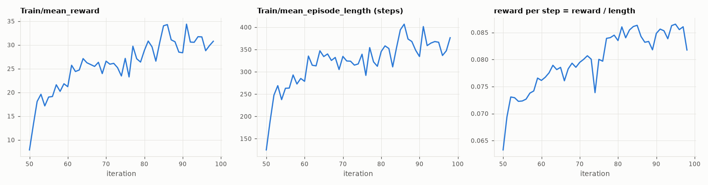
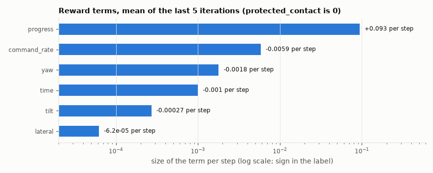
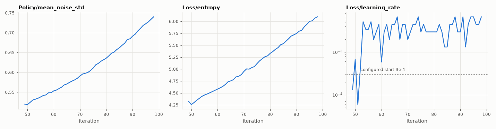
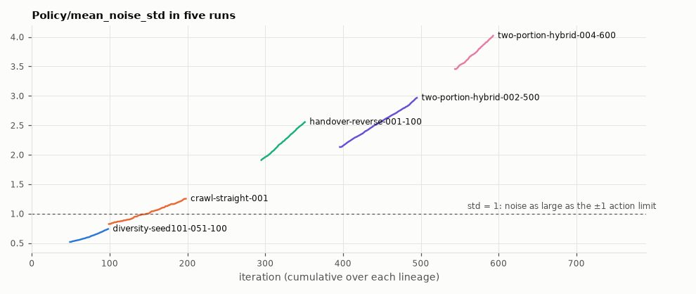
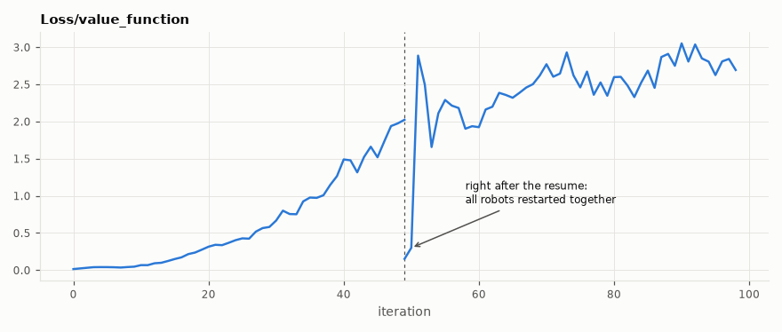

# Reading RSL-RL training curves

Notes from a question-and-answer session on 2026-10-22 that worked through the TensorBoard curves of `diversity-seed101-051-100`, the 20 Hz crawl policy that ran on arm 2. Each section gives what the plot showed, why, and the rule to keep. Practise on other runs with the [worksheet](training-curves-worksheet.md).

All figures are raw curves (TensorBoard smoothing 0), drawn by `scripts/plot_training_curves.py` from [`training-scalars.json`](training-scalars.json). Research-grade analysis of the same runs is in [`docs/research/reward-design-study.md`](../research/reward-design-study.md).

## Units first

| Quantity | Meaning |
|---|---|
| x-axis | **PPO iteration**, not robot steps. Each iteration: every environment acts for one rollout (64 steps at 20 Hz, 160 at 50 Hz; both 3.2 s), then PPO updates once. A resumed run continues its parent's count, so `051-100` starts at iteration ~50. |
| Experience per iteration | environments × 3.2 s. This run: 2048 × 3.2 s ≈ 1.8 robot-hours; its 50 iterations ≈ 91 robot-hours, simulated in about 7 minutes of training time (`Perf/collection time` + `Perf/learning_time`). |
| `Train/mean_episode_length` | **steps**, averaged over episodes that *finished* recently. 20 Hz: 20 steps/s, time limit 120 s = 2400 steps. 50 Hz runs: 50 steps/s, limit 6000 steps. |
| `Reward/<term>` | that term's mean value **per step**. `Train/mean_reward` is the total per **episode**. |
| Rollout length | Not the episode length. Episodes carry on across iterations; 64 steps is only where collection pauses for an update. 64 was the original default and has never been tuned (`scripts/train.py:29-32`). |

## 1. Reward grew mostly because episodes got longer



`Train/mean_reward` roughly quadrupled (7.9 → 30.8), while `Train/mean_episode_length` tripled (125 → 376 steps). Reward per step (reward ÷ length) only rose from about 0.063 to 0.082, and `Reward/progress` from 0.079 to 0.093. Most of what this chunk learned was to **survive longer**, not to crawl much faster.

**Rule:** divide reward by episode length before calling a run "better".

## 2. Episodes end at the lane, not the time limit

376 steps at 20 Hz is about 19 s, roughly 15 % of the 120 s limit, so nearly every episode is cut short by a termination (`src/le_snail/sim/env.py:614`):

| Termination | Ruled in or out |
|---|---|
| invalid simulation state | rare |
| protected contact | `Reward/protected_contact` is 0 for the whole run |
| base below the floor, fallen too long | crawl stage starts upright, and this policy never fell in its sim evaluation |
| **base more than 15 cm sideways from its start line** | matches the robust physics-v2 evaluation (seeds 4000–4014): 4 of 5 crawl trials left the lane after 11–18 s |

**Rule:** compare episode length with the time limit. If it is far below, find out which termination is doing it.

## 3. The reward barely charges for turning



`progress` is about 50× larger than the `yaw` penalty and about 1,500× larger than the `lateral` penalty. Turning and drifting are almost free; the only real pressure to go straight is the hidden cost of the lane termination (all future progress is lost).

**Rule:** rank the `Reward/*` terms by size. Anything orders of magnitude below the main term is not shaping behaviour.

## 4. The policy cannot see what it would need to go straight

The 24 policy inputs are joint angles, filtered joint speeds, gravity direction, gyro and the previous command. None of them gives **heading** or **sideways position**:

- gravity reads the same whichever way the robot faces;
- the gyro gives the turning *rate* now, and the feed-forward network has no memory to add rates up into a heading;
- moving the robot 10 cm sideways changes none of the 24 numbers.

So the best the policy can learn is to keep each step's turn small, and the small errors add up. The result: in a 3-minute sim run with no lane it crawled a 10.1 m path but ended only 3.8 m from its start, and on the real arm its heading changed by +16°, −17° and +23° in three 12 s runs.

**Fix:** give the actor its heading relative to the start, which the Xsens quaternion provides on the real robot, and make turning cost something. Sideways position cannot be measured on the robot, but it stays small if heading is held.

## 5. Noise std rising means the reward signal is weak



During training each action is `network output + Normal(0, std)`. The deployed `policy.pt` runs the network output only, with no noise.

- `Policy/mean_noise_std` rose from 0.52 to 0.74. On a ±1 action range that is very noisy: for `shoulder_lift` (scale 1.2 rad) a typical kick is about 0.9 rad.
- Most of that noise never reaches the joint. The contract's 1 rad/s rate limit allows only 0.05 rad of target change per 50 ms step, so random kicks turn into a small random walk. The noise therefore costs little reward.
- std is learned. The entropy bonus (coefficient 0.01) always pushes it up; the reward gradient pushes it down only when noise costs reward. Here the push up won.
- `Loss/entropy` is the same information on a log scale: for a Gaussian it is a constant plus log std for each joint.
- `Loss/learning_rate` uses an adaptive schedule that raises the rate when updates change the policy too little (KL below target 0.01). It went from the configured 3e-4 to 6.7e-3, about 20× higher.

Together: the policy cannot clearly tell better actions from worse ones, so nothing pulls std down.



The later runs went further: std 2–4. With std σ, a near-zero output is clipped to ±1 with probability P(|z| > 1/σ):

| std | share of training actions clipped |
|---|---|
| 0.74 (this run) | ~18 % |
| 2 | ~62 % |
| 3 (`two-portion-hybrid-002-500`) | ~74 % |
| 4 (`two-portion-hybrid-004-600`) | ~80 % |

### Correction: rising std is not a verdict

During the session I suggested this could explain why `two-portion-hybrid-002-500` failed to get up on the real arm. **That was wrong.** Its noise-free sim evaluation got up 5/5 on each side (`HANDOFF.md`, 2026-10-16 chunk 5), and its get-ups were learned while std was climbing from 1.3 to 3.0. Rising std means the gradient on std is weak relative to the entropy bonus, mostly because clipping and the rate limit make the applied target barely depend on std. It does not mean the network output learned nothing. 002-500's failure on the real arm is a sim-to-real problem.

**Rule:** steadily falling std alongside rising reward is the healthy pattern. Rising std is a warning about the training dynamics. The verdict on the deployed policy comes from a noise-free evaluation, in sim and then on the robot. Std collapsing to near 0 early is the opposite warning: exploration stopped before anything good was found.

## 6. The critic is blind to the lane



The critic (value function) predicts the discounted reward still to come. PPO uses it as the baseline for "better than expected". `Loss/value_function` is its squared error.

- The first chunk ended at about 2.0; the resumed chunk settles at 2–3. That is this critic's normal level.
- The odd points are 0.15 and 0.30 right after the resume. A resume restarts all 2048 robots at once. In the first iteration (0–3.2 s) no episode ended at all: `Train/*` has no point at iteration 49, because RSL-RL logs it only once an episode has finished. By the end of the second (3.2–6.4 s) only a few had, the fastest lane exits, which is why the first logged episode length is 125 steps. With almost no terminations in the batch, the future is easy to predict.
- When lane exits begin (iteration 51, 6.4–9.6 s into the episodes), the loss jumps to 2.9.

The critic gets the same 24 inputs as the actor (`"critic": ["policy"]` in `run.json`). Two robots with identical inputs, one in the middle of the lane and one 1 cm from the edge, have very different futures, and the critic must give both the same prediction. More training cannot remove that error.

**Fix:** an asymmetric (privileged) critic that gets simulator ground truth such as lateral position, heading, base velocity and time remaining. It is discarded before deployment. The research note proposes this as "critic38" (`docs/research/reward-design-study-gpu.md`). It gives the actor better feedback but not new information, so the actor still needs its heading input.

## 7. Ignore the first iterations after a resume

Both effects come from all environments restarting together:

- **Value loss** dips because the futures of freshly started episodes are easy to predict (section 6).
- **Episode length** starts low (125 → 238 in 4 iterations) because only finished episodes are averaged, and the shortest finish first (survivorship).

The same happens at the start of a fresh run. There, the average episode length is also capped by elapsed time.

**Rule:** after a resume, give every curve a few iterations to settle before reading it.

## Checklist

| Plot | Question it answers |
|---|---|
| `Train/mean_reward` ÷ `Train/mean_episode_length` | Is the policy better at each step, or just surviving longer? |
| `Train/mean_episode_length` vs the time limit | Are episodes cut short, and by which termination? |
| `Reward/*` terms against each other | What does the reward actually care about, and what is nearly free? |
| `Policy/mean_noise_std` with `Loss/entropy` | Is the reward signal strong enough to make the policy confident? |
| `Loss/learning_rate` (adaptive) | Are updates changing the policy, or stalling? |
| `Loss/value_function` | Can the critic predict the future from what it sees? |
| First iterations after any resume | Ignore them. |

A training curve is never the final word: the crawl and get-up counts from noise-free evaluation are.

## Reproducing

The TensorBoard event files are not in the repo; each run's `events.out.tfevents.*` lives in its `runs/<run>/` folder on the GPU host. To browse them, copy them into one folder per run and start TensorBoard:

```bash
uvx --from tensorboard==2.18.0 --with "setuptools<70" tensorboard --logdir <folder>
```

Regenerate the scalar export and the figures:

```bash
uv run --no-project --with tensorboard==2.18.0 --with "setuptools<70" \
    scripts/export_training_scalars.py <folder> docs/learning/training-scalars.json
uv run --no-project --with matplotlib --with numpy \
    scripts/plot_training_curves.py docs/learning/training-scalars.json docs/learning/figures
```
