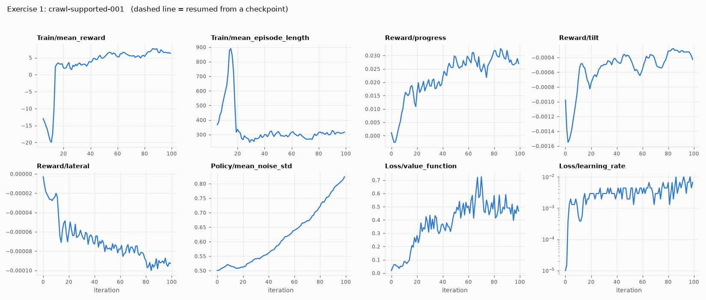
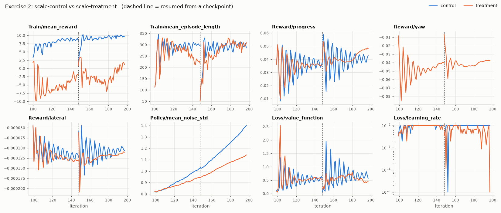
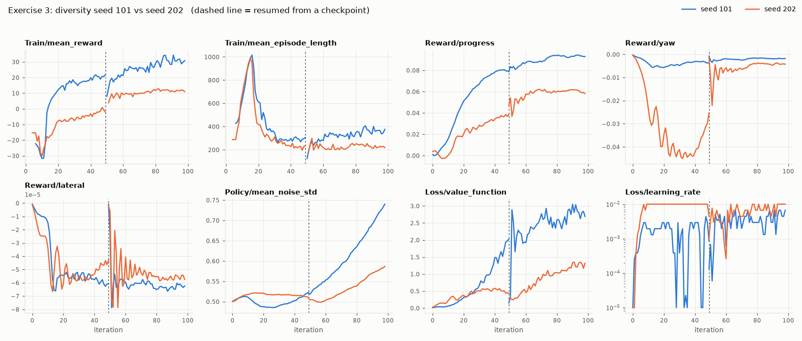
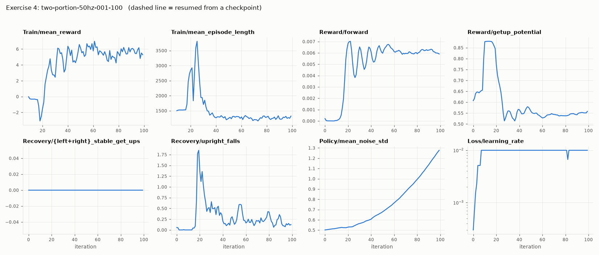
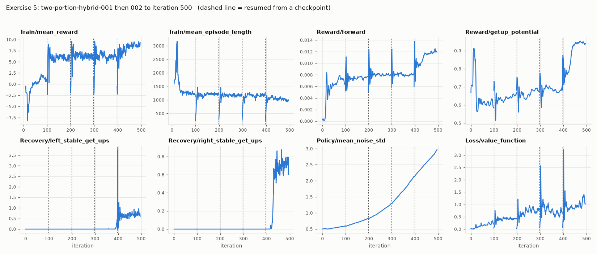
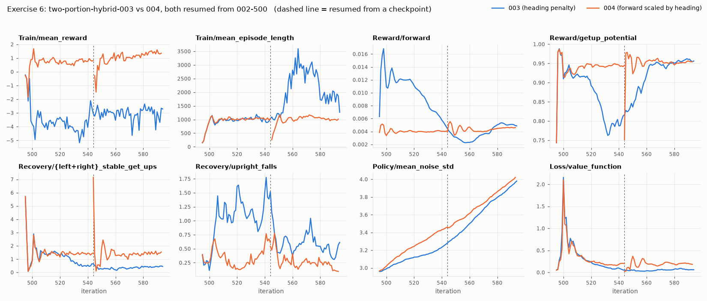

# Training curves worksheet

Six real training runs from this project, each drawn as one dashboard of raw curves. Read the setup box, study the plot, and write your answers down before opening the [answer key](training-curves-answers.md). The answers use what actually happened afterwards: sim evaluation counts, and whether the run was continued or stopped.

Start with [Reading RSL-RL training curves](reading-training-curves.md) for the units and the rules you'll need.

**On every dashboard:**

- **x-axis:** the PPO iteration, counted across the whole lineage.
- **Dashed vertical line:** the run was resumed from a checkpoint there. Ignore the first few iterations after one.
- **Robot time per iteration:** environments × 3.2 s.
- **Episode length:** counted in steps, at 20 steps/s for 20 Hz runs and 50 steps/s for 50 Hz runs.
- **Reward terms:** each `Reward/*` curve is that term's mean value per step.
- **Get-ups and falls:** each `Recovery/*` curve is the mean count of that event per control step. Multiply by 160 to get events per iteration.

There are two reward families:

| Family | Exercises | Terms |
|---|---|---|
| Crawl reward | 1–3 | `progress` (forward motion, paid only when upright), `yaw`, `lateral`, `tilt`, `command_rate`, `time` |
| Two-portion reward | 4–6 | `forward` (crawling), `getup_potential` (how close to upright), plus get-up, standing, effort and contact terms, and per-side get-up counters |

---

## Exercise 1: learning to crawl from nothing

| Setup | |
|---|---|
| Run | `crawl-supported-001` |
| Start | fresh network, seed 42, crawl stage (every episode starts upright) |
| Size | 256 envs × 64 steps at 20 Hz: 0.23 robot-hours per iteration; 100 iterations in 5 minutes |
| Reward | crawl reward **without** a yaw term (that's why `Reward/tilt` replaces `Reward/yaw` on the dashboard) |
| Episode limit | 2400 steps (120 s) |

1. At what iteration does the robot start making forward progress? Which panel shows it most directly?
2. `Train/mean_episode_length` climbs to about 900 by iteration 15, then crashes to about 300. Explain both halves.
   - Hint: at iteration 10, what is the longest an episode could possibly have lasted?
   - Hint: once the robot moves, what ends its episodes?
3. After iteration ~60, is the policy still improving? Name the panels that tell you.
4. Compute reward per step at iteration 99. Then use section 2 of the notes to estimate how long an average episode lasts in seconds.
5. This reward has no yaw term. Using only these curves, would you expect this policy to crawl straight?

---

## Exercise 2: adding a penalty (a matched pair)

| Setup | |
|---|---|
| Runs | `scale-control-*` and `scale-treatment-*`, each two chunks of 50 iterations |
| Start | both resume `crawl-supported-001` at iteration 99, same seed (42), same 4096 envs |
| Size | 3.6 robot-hours per iteration; about 23 minutes per lineage |
| The one difference | the treatment adds a yaw cost of `−1.0 · dt · (1 − cos(yaw − yaw_at_start))`. The control has no yaw term, so it draws no line on `Reward/yaw`. |

1. The treatment's `Train/mean_reward` drops to about −10 at once and stays below the control's for all 100 iterations. Is the treatment the worse policy? What is a fair way to compare these two runs?
2. Compare `Reward/progress` at the end. Which crawls faster?
3. `Reward/yaw` goes from about −0.085 at its worst to about −0.037. What is the treatment learning? Remember that heading is not one of the policy's inputs, so what could the policy actually be changing?
4. Which run's noise std grows faster? Suggest why the yaw term might slow it down.
5. `Loss/learning_rate` sits at 1e-2 for most of both runs. What does that tell you? (1e-2 is the schedule's ceiling.)
6. Predict the sim evaluation, where a pass means crawling 50 cm while staying inside the 15 cm lane. Which run passes more often? How confident can you be from one matched pair?

---

## Exercise 3: same recipe, different seed

| Setup | |
|---|---|
| Runs | `diversity-seed101-*` and `diversity-seed202-*`, each two chunks of 50 iterations |
| Start | both fresh networks. Same config, same code, same 2048 envs; only the random seed differs. |
| Size | 1.8 robot-hours per iteration; about 19 minutes per lineage |
| Reward | crawl reward **with** the yaw cost (weight 1.0) |

1. How different are the two runs at iteration 98, in `Reward/progress` and `Reward/yaw`?
2. Between iterations 20 and 45, seed 202's yaw penalty is about ten times seed 101's. What does that say about how each gait moves?
3. Seed 202's episodes are shorter (about 220 vs 375 steps). Connect that to question 2.
4. Both runs show an episode-length peak of about 1000 near iteration 15. You've seen this before. What is it?
5. Which seed's value loss is higher at the end? Is a higher value loss here a sign of a worse run? (Hint: notes section 6, and remember which run survives longer.)
6. Suppose you ran only seed 202 and concluded "this reward doesn't produce a crawl". What would you have got wrong? What does it suggest about comparing two configs with one seed each?

---

## Exercise 4: continue or stop?

| Setup | |
|---|---|
| Run | `two-portion-50hz-001-100` |
| Start | fresh network, seed 42, 50 Hz contract, recover stage: a mix of upright starts and side starts that need a get-up |
| Size | 8192 envs × 160 steps: 7.3 robot-hours per iteration; 100 iterations in 112 minutes |
| Reward | two-portion reward, with separate crawling and get-up portions |
| Episode limit | 6000 steps (120 s) |
| Pre-registered rule | continue in 100-iteration chunks only while side get-ups or the forward reward rose over the last two 10-iteration windows |

1. How many stable get-ups happened over the whole run, on either side?
2. After about iteration 40, are `Reward/forward` and `Train/mean_reward` rising or flat?
3. Noise std rises from 0.5 to 1.28, and the learning rate sits at its 1e-2 ceiling. Read these two together.
4. Episode length settles around 1300 steps. How many seconds is that at 50 Hz? Why would an average over a mix of upright and side starts be hard to interpret?
5. Apply the pre-registered rule. Continue or stop?
6. If you stop, what would you change for the next run so that a get-up actually happens often enough to be learned?

---

## Exercise 5: something appears after 300 flat iterations

| Setup | |
|---|---|
| Runs | `two-portion-hybrid-001-100`, then `two-portion-hybrid-002-200` to `-500`. Five chunks of 100 iterations, each resumed from the previous one. |
| Start | fresh network, seed 42, 50 Hz contract, robust stage (randomized masses and physics) |
| Size | 7.3 robot-hours per iteration; about 105 minutes per chunk |
| What's new | in half the episodes, the scripted hybrid controller drives the first part and then hands control to the policy. Entropy coefficient is 0.005 (half the earlier runs' value). |
| Change at 100 | chunk 1 had a heading penalty; from chunk 2 onward it was dropped |
| Sim evaluation after each chunk (crawl / left / right, out of 5) | 0/0/0, 1/0/0, 0/0/0, 0/5/0, 1/5/5 |

1. Find the four resume lines. What happens to `Train/mean_episode_length` and `Loss/value_function` at each?
2. When do left get-ups first appear? Right get-ups? What changes in `Reward/getup_potential` and `Train/mean_reward` at the same time?
3. The left get-up curve spikes to about 3.7 right after the resume at ~396, then falls back. Real, or an artifact?
4. For 300 iterations, get-ups were exactly 0. A "stop when flat for 100 iterations" rule would have stopped this lineage at 300. Is there any curve on this dashboard that hinted something was building?
5. Noise std rose from 0.5 to 3.0 over the whole lineage, and the get-ups were learned while it rose. Does this break the rule "falling std means the policy can tell good actions from bad"? Restate the rule so it survives this run.
6. `Reward/forward` is at its highest in chunk 5, yet the crawl evaluation passed only 1 of 5. How can both be true?
7. The final policy, `002-500`, got up 5/5 on each side in sim evaluation without noise, but it did not get up on the real arm. Would these curves help you find out why? If not, where would you look?

---

## Exercise 6: two fixes for the same problem

| Setup | |
|---|---|
| Runs | `two-portion-hybrid-003-600` (100 iterations) and `two-portion-hybrid-004-550` + `-600` (2 × 50 iterations) |
| Start | both resume `002-500`, from exercise 5 |
| The problem | 002-500 gets up on both sides, but its crawls turn into the lane edge |
| 003's fix | a heading penalty, `−1.0/s × ramp(abs(world yaw), 15° to 60°)`, applied only while crawling |
| 004's fix | no penalty. Instead the forward pay is scaled down when the heading is off: full pay below 15°, down to 25 % at 60°. |
| Stop rule | stop if upright falls exceed twice the 002-500 baseline in most windows |

1. Compare `Recovery/upright_falls` in the two runs.
2. What happens to stable get-ups in 003? In 004?
3. 003's episode length shoots up to about 3000 steps (60 s) around iterations 555–580. Is that good news? Look at `Reward/forward` over the same stretch.
4. 003's mean reward is about −3 and 004's about +1. Can you compare those two numbers directly?
5. Which run would you keep training? Predict their crawl / left / right sim evaluation counts.
6. In one sentence: why might a penalty change behaviour more destructively than scaling down a payment?
