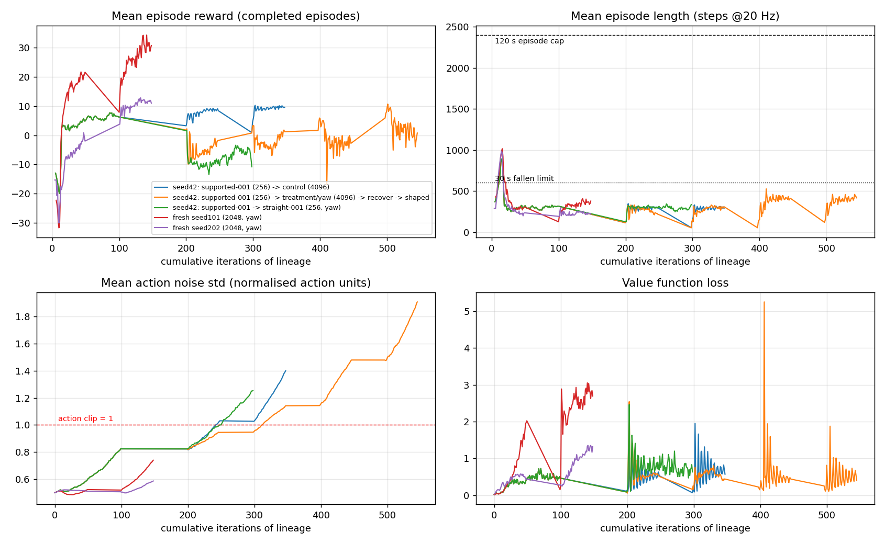
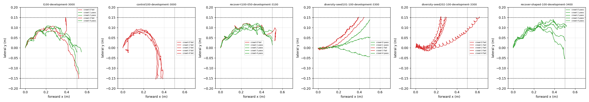
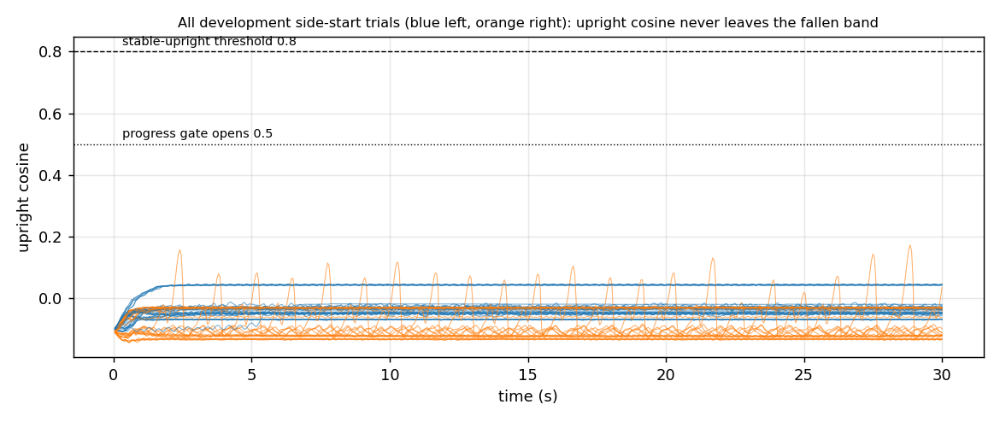

# Reward-design study: longer training, more environments, or a better objective?

Date: 2026-10-14. Independent, read-only review of the Le Snail PPO locomotion work (simulation stage). Question from the owner: *"Should we put effort into longer training, or many more parallel environments, or is the reward itself not good enough for what we are trying to achieve?"*

Evidence base: the TensorBoard event files and per-iteration reward-component logs of all 13 training runs, 129 recorded evaluation trials (per-step traces and reports), the final checkpoints and export-parity tensors of 9 runs, the environment/trainer source, and the project's own reviews. All analysis ran on CPU from recorded data; no simulation was run and no project file was changed other than this report and its figures (`reward-design-study/`). Every number below is tagged **[measured]** (read from data/code), **[inferred]** (derived from measurements with stated assumptions) or **[speculative]**.

Independence note: this study was written without reading `docs/research/reward-design-study-gpu.md` or any `runs/reward-study-gpu-*/` material (neither existed when this review inventoried the workspace). From the coordination log only the pre-noon experiment history and the message that *assigns* the GPU-side study (no results) were read.

---

## 1. Executive answer

1. **The reward is the primary problem for recovery and a real, secondary problem for crawl straightness. Training length and environment count are not the bottleneck, and more of either will not produce recovery.**
2. Recovery: **0 stable get-ups in 19,520 completed side-start episodes** (two 50-iteration chunks at 4096 envs) [measured]. The reward charges a fallen robot 30 reward units per metre of *backward* base motion while crediting nothing for forward motion (gate), so wriggling costs −0.2 to −22 per 30-s trial [measured]; the only positive recovery signal is capped at +1 per episode and actually paid out at 0.07 (left) and 0.002 (right) per episode [measured]; the fallen reward stream is negative, so any termination is a relief [inferred]. The best fallen policy under this reward is to lie still, which is what the policies do (highest upright cosine reached in the 60 development side trials: 0.05, start ≈ −0.10; 0.17 in one diagnostic trial) [measured]. The get-up itself is physically feasible but narrow (7–26 % of ±0.1 rad perturbations of a scripted plan succeed, project feasibility study) and i.i.d. Gaussian noise through a 1 rad/s slew cannot find it: the implied per-episode success rate is < 1.5e-4 (95 % bound), i.e. < 0.03 successes per 4096-env iteration at the measured ~195 completed side episodes per iteration [inferred].
3. Crawl: the distance test is already passed 3/5 to 5/5 on development seeds [measured], but as a race: 50 cm is reached in 6–12 s and the lane is left at 7–16 s because the base turns (net −8 to −12°/s for the seed-42 gait family) [measured]. Straightness is enforced only by an unobservable termination; the lateral cost is ~0.1 % of the progress reward and the command-rate cost is saturated at 97 % of its maximum in every run [measured]. More iterations improve speed (+10–50 % per 100 iterations) and will probably lift development pass rates to 4–5/5, but will not change the failure mechanism, and the exploration noise is drifting (std 0.5 → 1.9; 40–60 % of the deterministic policy's action means already lie beyond the ±1 clip) [measured].
4. Environment count: there is no matched evidence that it matters beyond wall-clock. The largest effect observed is the gait family found by the seed: fresh seed 101 at 2048 envs is 2× faster and 5× straighter than the seed-42 lineage at the same reward [measured]. The main lineage has consumed 54 M transitions, roughly two Isaac Lab flat-terrain budgets (~30 M) [measured].
5. Plan: (i) reward and trainer fixes (one matched pair of 100-iteration runs, < 1 GPU-hour); (ii) recovery via reference-state initialisation along the validated scripted get-up paths with a reverse curriculum (1–2 GPU-hours); (iii) only then spend compute: a 3–4-seed fresh sweep, 300–500 iterations for the winner, the robust stage, one held-out qualification.

---

## 2. What the policy currently optimises

Per control step (dt = 0.05 s), from `src/le_snail/sim/env.py` `_get_rewards` and the experiment configs [measured]:

```
u      = upright cosine (−gravity_b,z);  g(u) = clip((u − 0.5)/0.3, 0, 1)
Δx     = x_t − x_{t−1} of the base root in world frame (start heading = +x)
r_t =  30 · [ min(Δx,0) + g(u) · max(Δx,0) ]                 progress, posture-gated for positive Δx only
     − 0.1  · dt · (1 − u)                                   tilt
     − 0.3  · dt · y²                                        lateral displacement from the start line
     − 0.02 · dt · Σ_j ((target_j − target_j,prev)/dt)²      command rate (slew-limited to 1 rad/s per joint)
     − 0.02 · dt                                             time
     − 1 · [protected contact]                               inactive: protected_points is empty
     − 1.0  · dt · (1 − cos(ψ − ψ₀))                         base yaw error (all runs after crawl-supported-001)
     + 1.0  · Δ max_t clip((u − u_reset)/(0.8 − u_reset),0,1) side-start episodes only, cap 1/episode (recover-shaped run only)
```

Terminations (no value bootstrap): `|y| > 0.15 m`, fallen (`u < 0.5`) continuously for > 30 s, non-finite state, `z < −0.03 m`. Truncation with bootstrap at 120 s (2400 steps). PPO (`scripts/train.py`): γ = 0.995 (horizon 1/(1−γ) = 200 steps = 10 s), λ = 0.95, 64 steps/env/iteration, 5 epochs, entropy coefficient 0.01, adaptive KL schedule with target 0.01 (hard-coded learning-rate bounds 1e-5…1e-2 in RSL-RL 3.0.1), init std 0.5 (state-independent, one scalar per action), actor/critic [128,128] ELU, identical 24-value actor and critic inputs.

### 2.1 Measured magnitudes

Table 1. Per-trial totals of each term on the 90 development trials (six full 15-trial sets), by outcome class. The command-rate term is not reconstructible from traces; from the training logs it is −0.0057 to −0.0058 per step (−0.115/s) in every run, i.e. ≈ −1.2 per 10-s crawl and −3.5 per 30-s side trial [measured].

| class (n) | progress | of which backward motion charged while fallen | yaw (1−cos) | tilt | time | lateral | total (excl. cmd-rate) |
|---|---|---|---|---|---|---|---|
| crawl pass (15) | +14.9 | 0 | −3.5 (−0.05…−8.8) | −0.08 | −0.20 | −0.02 | **+11.2** |
| crawl lane-exit upright (13) | +10.7 | −0.07 | −5.6 | −0.11 | −0.22 | −0.02 | **+4.7** |
| crawl that fell (2) | +0.7 | −6.7 | −23.3 | −3.3 | −0.70 | −0.03 | **−26.6** |
| side start, never recovers (60) | **−7.6** (−22.2…−0.2) | −7.6 | −4.8 (−15.5…0) | −3.2 | −0.60 | 0.00 | **−16.2** (−34…−6) |

Table 2. Per-second rates that the critic actually sees [inferred from Table 1 and the logs].

| situation | reward rate |
|---|---|
| crawling at 5 cm/s, straight | +1.5/s progress − 0.1/s cmd-rate − 0.04/s tilt+time ≈ **+1.35/s** |
| crawling with the seed-42 gait (net turn 8–12°/s, ±55°/s rocking) | +1.35/s − 0.3…0.7/s yaw ≈ **+0.7…+1.0/s** |
| upright, still | **−0.04/s** |
| fallen, still | −0.11/s tilt − 0.02/s time ≈ **−0.13/s** |
| fallen, moving (what the policies do) | −0.13/s − progress charge 0.1…0.7/s − yaw up to 0.4/s ≈ **−0.2…−1.1/s** |
| lane exit or 30-s fallen termination | stream ends, terminal value 0 |

Discounted values (γ = 0.995) [inferred]: V(crawl pass) ≈ +5 to +11 over the 6–12 s of a pass (asymptotically +15 for sustained crawling); V(fallen still, 30 s) ≈ −1.2; V(fallen moving) ≈ −2.4 to −10.7 (measured G₀ of the side trials). The *incentive* to recover (≈ +15 vs −1) exists; what is missing is any gradient toward it.

---

## 3. Evidence

### 3.1 Learning dynamics and scaling



Figure 1. Mean episode reward, mean episode length, action noise std and value loss for all lineages, versus cumulative iterations. Per-step reward components are in `reward-design-study/reward-components.png`; learning rate and entropy in `reward-design-study/lr-entropy.png`.

Table 3. Run statistics (first 5 vs last 5 iterations of each chunk) [measured].

| run | envs × its | transitions | progress reward / step | yaw / step | noise std | episode length (steps) | notes |
|---|---|---|---|---|---|---|---|
| crawl-supported-001 (seed 42) | 256 × 100 | 1.6 M | −0.001 → 0.027 | – | 0.50 → 0.81 | 432 → 312 | gait appears, turns |
| crawl-straight-001 (resume, +yaw) | 256 × 100 | 1.6 M | 0.032 → 0.031 | −0.050 → −0.049 | 0.83 → 1.25 | 222 → 301 | no change |
| scale-control (resume) | 4096 × 100 | 26.2 M | 0.0315 → 0.0368 → 0.0403 | – | 0.82 → 1.38 | 233 → 296 | LR pinned at 1e-2 cap |
| scale-treatment "T100" (resume, +yaw) | 4096 × 100 | 26.2 M | 0.032 → 0.036 → 0.048 | −0.050 → −0.037 | 0.82 → 1.13 | 229 → 300 | dev crawl 3/5 |
| recover-t100 (35 % side starts) | 4096 × 50 | 13.1 M | steady ≈ 0.012 → 0.021 | −0.037 → −0.016 | 1.15 → 1.46 | ≈ 400 (mixture) | 0 get-ups |
| recover-shaped (+capped shaping) | 4096 × 50 | 13.1 M | steady ≈ 0.025, flat | −0.027 → −0.013 | 1.48 → 1.88 | ≈ 420 | 0 get-ups; dev crawl 5/5 |
| fresh seed 101 (+yaw) | 2048 × 100 | 13.1 M | 0.001 → 0.080 → 0.093 | −0.001 → −0.002 | 0.50 → 0.73 | 291 → 359 | dev crawl 3/5; still rising |
| fresh seed 202 (+yaw) | 2048 × 100 | 13.1 M | 0.003 → 0.037 → 0.059 | −0.003 → −0.004 | 0.50 → 0.58 | 334 → 225 | dev crawl 0/5; still rising |

Readings:

* **Nothing has plateaued, but the improvement is slow and of the wrong kind.** Progress per step still rises in every crawl lineage (+10 %/50 iterations for control, +50 %/100 for treatment, +15 %/50 for seed 101) [measured]. What rises is speed, not straightness: the mean episode length stays at ≈ 300 steps (15 s) throughout every crawl run, against a 2400-step cap [measured]. Since nothing else terminates upright episodes, essentially every training episode ends by lane exit at ~15 s [inferred]. The policies have never experienced a long in-lane episode; "stay in the lane for 120 s" is not in the data distribution.
* **Scaling with environments: no matched evidence.** The only matched comparison in the data is control vs treatment (same envs, seed, start): the yaw term, not scale, separated 0/5 from 3/5 [measured; one pair, one seed]. Seed 101 at 2048 envs reached 0.093 progress/step at iteration 100, twice the seed-42 lineage at iteration 200 on 4096 envs [measured]. Environment count mainly bought wall-clock (8 s/iteration at 4096 envs ≈ 33 k transitions/s).
* **Budget context.** Isaac Lab's ANYmal-C flat-terrain recipe is 4096 envs × 24 steps × 300 iterations ≈ 29 M transitions, rough terrain 1500 iterations ≈ 147 M [source 3]; Rudin et al. report flat policies in under four minutes [source 1]. The seed-42 lineage has used 54 M, each fresh seed 13 M. The claim in the coordination log that training was "~100× below typical budgets" was true at 1.6 M and is no longer true.
* **Mixture artefact.** In the recover-stage runs the mean episode reward (Figure 1, top-left) drops after resume only because 30-s fallen episodes with negative return enter the 100-episode buffer after ~10 iterations; the per-step progress is flat, not declining [measured; see `reward-components.png`].

### 3.2 How crawl trials fail



Figure 2. Base path (x forward, y lateral) of every development crawl trial; dashed = lane, dotted = 50 cm. Green pass, red fail.

Table 4. Development evaluations (robust physics, deterministic policy) [measured].

| policy | seeds | crawl | left | right | time to 50 cm (passes) | net base yaw rate | yaw-rate RMS | dominant gait freq. |
|---|---|---|---|---|---|---|---|---|
| control-100 (seed 42, no yaw cost) | 3000–3014 | 0/5 | 0/5 | 0/5 | – (lane exit at 0.32–0.39 m) | −11.5°/s | 46°/s | 0.8 Hz |
| T100 (seed 42, yaw cost) | 3000–3014 | 3/5 | 0/5 | 0/5 | 10.3–12.5 s | −10.8°/s | 55°/s | 0.5 Hz |
| recover-50 (T100 + recovery stage) | 3100–3114 | 4/5 | 0/5 | 0/5 | 9.8–10.5 s | −8.3°/s | 52°/s | – |
| recover-shaped-100 | 3400–3414 | 5/5 | 0/5 | 0/5 | 8.6–11.8 s | −8.2°/s | 56°/s | 0.5 Hz |
| fresh seed 101 | 3300–3314 | 3/5 | 0/5 | 0/5 | 5.8–12.0 s | +2.4°/s | 29°/s | 3–6 Hz |
| fresh seed 202 | 3300–3314 | 0/5 | 0/5 | 0/5 | – (61.8 cm reached but not stable upright) | +8.7°/s | 44°/s | 1.4–2 Hz |

* Every upright failure is a lane exit while still upright (13 of 15 crawl failures; the other 2 are falls) [measured]. Lateral displacement at the moment 50 cm is reached is up to 0.139 m (seed 101) and 0.115 m (shaped) [measured]: the margins are centimetres.
* The seed-42 family moves by slow base pivoting (0.5 Hz, ±55°/s yaw rate) with a systematic net turn; seed 101 found a fast small-amplitude stepping gait (3–6 Hz, net turn 2°/s) that is 2× faster [measured]. Base yaw and direction of travel are decoupled for the pivoting gait (T100 passes with −110…−150° of base yaw), so the 1−cos(ψ) term partly penalises the gait itself rather than the drift [inferred].
* The posture gate rarely bites while crawling: 95–100 % of positive displacement is credited in upright trials [measured]. Its top (0.8) coincides with the acceptance threshold. Keep it.

### 3.3 Why recovery never starts



Figure 3. Upright cosine of all 60 development side-start trials; none leaves the fallen band.

* Counters: left 5,720 + 5,850 started, right 6,103 + 6,025 started; 19,520 completed; 0 reached upright cosine ≥ 0.8 for 0.5 s; all completed episodes ended at the 30-s fallen limit [measured, `recovery-diagnostics.json`]. Shaping credit paid: 411.5 (left, 0.07/episode) and 14.6 (right, 0.002/episode) against a cap of 1 [measured].
* **The reward punishes movement while fallen.** With `credited = min(Δx,0) + g·max(Δx,0)` and g = 0 when fallen, every backward millimetre of base oscillation costs 0.03 while forward motion earns nothing. Measured charge: −7.6 per 30-s side trial on average, up to −22 (T100 right side); the shaped policy still pays −9 to −11 on the right [measured]. This is 10–20× the shaping cap, and it falls on exactly the exploratory rocking a get-up requires. The policies responded rationally: right-side trials move 0.1–0.2 cm/s and never raise the upright cosine [measured].
* **Termination is a relief.** The fallen stream is negative (Table 2) and both the 30-s fallen limit and a lane exit end it with terminal value 0. Two side trials actually ended by sliding out of the lane while fallen (scale-treatment-050 right at 28 s, scale-control-050 right at 9.7 s) [measured]; in training this is a positive-advantage event [inferred].
* **Exploration arithmetic.** Actions are clipped to ±1 and then slew-limited to 0.05 rad per step, so i.i.d. Gaussian noise of any std ≳ 0.1 becomes six independent ±0.05 rad/step random walks (std 0.22 rad after 1 s, 0.45 rad after 4 s) [inferred from `_pre_physics_step`]. The successful scripted get-up is a 3–5 s, five-joint sequence whose basin admits ±0.1 rad perturbations only 7–26 % of the time (project feasibility study, Isaac replay). Zero successes in 19,520 episodes bounds the per-episode success rate below ~1.5e-4; at the measured ~195 completed side episodes per iteration that is < 0.03 successes per 4096-env iteration and < 3 per 100 iterations; PPO cannot learn from that, and 10× more environments or iterations gives < 30 [inferred].
* The capped running-max shaping is well constructed against farming but too weak to matter, and the recover-shaped run shows no increase of `Reward/upright_progress` over 50 iterations (≈ 0.0000 per step) [measured].

### 3.4 Exploration noise, saturation and the trainer

* **Noise std grows without bound** in every resumed run: 0.50 → 0.81 (supported) → 1.13 (T100) → 1.46 → 1.88 (shaped); fresh seeds grow slower (0.73, 0.58 at 100) [measured]. Per joint at the final checkpoints [measured]:

| checkpoint | pan | lift | elbow | wrist_flex | wrist_roll | gripper |
|---|---|---|---|---|---|---|
| crawl-supported-001 | 0.57 | 0.80 | 0.73 | 0.93 | 0.94 | 0.97 |
| T100 | 0.62 | 0.97 | 1.01 | 1.24 | 1.41 | 1.60 |
| recover-shaped | 0.84 | 1.19 | 1.31 | 1.79 | 2.83 | 3.49 |
| fresh seed 101 | 0.97 | 0.47 | 0.37 | 0.45 | 1.08 | 1.10 |

  The std inflates most on joints that matter least for the reward (wrist roll, gripper). Mechanism [inferred]: because the clip and the slew limiter make the applied target almost independent of σ once σ ≳ 0.1, the surrogate loss has ~no gradient with respect to σ while the entropy bonus (coefficient 0.01, `loss = surrogate + value − 0.01·entropy` in RSL-RL 3.0.1 [source 4]) always pushes σ up. legged_gym avoids this because its actions are effectively unclipped (`clip_actions = 100`, scale 0.5) and the noise always reaches the joints [source 2].
* **Deterministic policies are saturated.** Fraction of mean-action components with |a| > 1 on the export-parity observations: supported 20 %, T100 41 %, control 41 %, shaped 60 %, seed 101 15 %, seed 202 19 %; fraction of observations with all six means inside (−1, 1): shaped 0.1 %, T100 4 %, seed 101 63 % [measured, `export-parity.pt`]. Mean |a| of the shaped policy on wrist_flex is 1.93. The gradient is computed on the unclipped Gaussian (the mismatch analysed by Fujita & Maeda [source 15]).
* **The command-rate term is saturated at 97 % of its maximum (−0.0058 of −0.006 per step) in every run, including deterministic-looking fresh seeds** [measured]. Under the exploration noise every joint ramps at the slew limit almost every step, so this regulariser carries no information about the policy mean. It is not restraining anything.
* **Learning rate at the hard cap.** The adaptive-KL rule drove the learning rate to its 1e-2 ceiling for most of scale-control-051-100 and seed 202 [measured]: with σ > 1 the per-update KL stays below 0.005, so the schedule keeps multiplying by 1.5 [inferred]. Value loss stays bounded, so this has not blown up, but it means the policy changes ever less per update in units of its own noise.

### 3.5 Credit assignment and partial observability

* The actor and the critic see the same 24 values. Base yaw error, lateral position, lateral velocity and time-fallen are unobservable to both, yet they decide the two terminations and the yaw cost. For the critic this is pure aliasing: the lane-exit hazard (~1/15 s) looks like random truncation, which inflates advantage variance and biases GAE with λ < 1 [inferred]. A privileged critic (Pinto et al. [source 9]; standard in Isaac Lab/legged_gym teacher-style training) is the orthodox fix; Baisero & Amato [source 10] show the naive state-only critic is formally biased under partial observability and propose conditioning on state *and* history. In practice the privileged critic helps on exactly this kind of hidden-hazard problem; the project's feasibility check (`runs/critic-feasibility-001`) already confirmed RSL-RL 3.0.1 supports it with the actor untouched.
* The actor *can* observe its instantaneous turning: the world-vertical angular rate is `−gyro_b · gravity_b`, both actor inputs. A turning cost expressed in that quantity is a function of observable state and recent history; the 1−cos(ψ) cost is a function of the whole episode's history and arrives late (quadratically growing), far outside the GAE credit window (1/(1−γλ) ≈ 18 steps ≈ 0.9 s). A 3-s exponential average of the yaw rate separates the gait families by 10–20× (RMS 2.4°/s seed 101 vs 9–9.5°/s seed 42 family vs 6.7°/s seed 202) while suppressing the within-stride rocking of the fast gaits [measured on traces]. Note that this proxy (quaternion-derived yaw rate in the traces) and the gyro-based proxy differ when tilted; both are available in simulation.
* The actor also sees which side it lies on (sign of gravity_b,y), so one policy can hold side-specific get-ups; no actor change is required for recovery.

### 3.6 Comparison with established practice

* legged_gym / Isaac Lab locomotion rewards are a large *positive* task term (velocity tracking, exp kernel, weights 1.0 and 0.5) plus small regularisers (action rate −0.01, torques −1e-5, joint acceleration −2.5e-7, z-velocity −2, roll/pitch rate −0.05, undesired contacts −1), termination on base contact, 20-s episodes, `only_positive_rewards = True` in legged_gym so that termination is never attractive [sources 2, 3]. Le Snail's structure is similar in spirit (progress ≫ regularisers) but its per-step total is negative whenever the robot is not progressing, which flips the sign of termination.
* PPO settings: legged_gym entropy 0.01, Isaac Lab ANYmal 0.005, init std 1.0 with unclipped actions, γ 0.99, 24 steps/env, 4 minibatches [sources 2, 3]. Le Snail's γ = 0.995 at 20 Hz (10-s horizon) is appropriate for its deadlines; its 64 steps/env and 16 minibatches are fine.
* Learned recovery: Lee, Hwangbo & Hutter trained ANYmal self-righting by dropping the robot "from 0.5 m above the ground with random joint positions", with an orientation term carrying the largest weight and a curriculum that starts the smoothness costs near zero [source 5]. Tao et al. discover get-ups with a *strong-actuation* curriculum first, then weaken and slow the motion [source 11]. Haarnoja et al. train the OP3 get-up by rewarding progress toward target poses interpolated between three hand-designed key poses, then use it as a regularisation target [source 12]. DeepMimic's ablation makes reference-state initialisation and early termination "two of the most important components" (backflip return 0.79 with both, 0.38 with RSI removed) [source 7]. Florensa et al. formalise the reverse curriculum: keep start states whose success rate lies in [R_min, R_max] = [0.1, 0.9] and expand from them by short random-action rollouts [source 6]. Every one of these either randomises or seeds the start distribution or supplies a pose prior; none relies on unassisted exploration from a single rest pose, which is what Le Snail has tried.
* I found no directly comparable published RL result for an arm crawling as an inchworm; the closest sim-to-real crawler work is Schaff et al. (soft crawling robots, RSS 2022) [source 16]. Treat the gait-level numbers here as project-specific.

---

## 4. Diagnosis (ranked by impact)

1. **Fallen-state objective is inverted** [measured + inferred]: backward-motion charge, negative stream, termination relief, +1 cap. Recovery cannot emerge from this reward regardless of compute.
2. **Recovery is an exploration problem that needs start-state or demonstration support** [measured basin width, 0/19,520]: fix the reward *and* seed the start distribution.
3. **Lane keeping is enforced only by a hidden termination; the dense proxies are either negligible (lateral 0.1 %) or late and gait-entangled (1−cos ψ)** [measured]. The task is passed as a race with centimetre margins.
4. **Exploration pathology**: entropy-driven std inflation through a clipped, slew-limited action path; saturated means; saturated command-rate term; learning rate pinned at the cap [measured + inferred]. This degrades every further iteration and widens the stochastic/deterministic gap.
5. **Critic aliasing** of hazard and heading [inferred]; cheap to fix.
6. **Seed/gait-family variance dominates** the scale and iteration effects seen so far [measured].
7. Sim-fidelity caveat outside the reward: the provisional 2 rad/s joint-velocity cap narrows the get-up basin (project feasibility study: 31/32 vs 7–26 % at 5.45 rad/s). This is a measurement/owner decision, not a reward one.

What is *not* wrong: progress in world x (correct for the acceptance test; do not switch to heading-aligned progress, which would reward turning-and-moving); the posture gate shape; settled starts; γ; the episode/termination structure itself; the 24-value actor interface (recovery and straightness are learnable with it, as seed 101 and the gravity-side cue show).

---

## 5. Recommended specification

### 5.1 Reward (per control step, dt = 0.05 s; all quantities simulator-side)

```
g(u)   = clip((u − 0.5)/0.3, 0, 1)                           posture gate (unchanged)
ω_up   = −(gyro_b · gravity_b)                               world-vertical turn rate from actor-observable signals
ω̄     ← ω̄ + (dt/3 s)·(ω_up − ω̄), reset to 0 at episode reset

r_t =  30 · g(u) · Δx                                        A  progress, gate applied to BOTH signs
     + 0.006 + 0.010 · g(u)                                  B  alive/upright bonus (replaces tilt and time costs)
     − 20  · dt · g(u) · ω̄²                                  C  turning cost, local and observable
     − 0.5 · dt · g(u) · (1 − cos(ψ − ψ₀))                    D  heading-error cost, halved, upright only
     − 0.02 · dt · Σ_j (Δtarget_j/dt)²                       E  command rate (unchanged; see 5.4)
     − 1 · [protected contact]                               F  unchanged
     + 3 · (u_t − u_{t−1})                                   G  potential-based uprightness shaping, Φ(s) = 3u, all episodes
     + 2 · [first stable-upright event, side-start episode]  H  once per episode, never in upright-start episodes
```

Rationale and checks:

* **A** removes the measured −7.6/trial movement charge while fallen; upright behaviour is unchanged (g = 1). Rolling or sliding while fallen still earns nothing, so the "no continuous rolling" requirement keeps its reward-side backing.
* **B** makes the per-step reward non-negative in every state (fallen: +0.006/step = 0.18/s; upright still: 0.32/s; crawling adds 1.5/s). Termination is never a relief, lane exit and the 30-s limit become real losses (≈ remaining time × 0.3/s plus progress), and the fallen-to-crawling value gap (≈ 1 vs 15) is preserved. It is not farmable: 30 s fallen earns 3.6, ten seconds of crawling earns 15. Replaces the −0.1(1−u) and −0.02 terms, whose only effect was to make the stream negative.
* **C** penalises what the actor can perceive and control within the GAE window. Counterfactual on the recorded trials [measured]: seed 101 −0.4 per crawl, shaped −3.6, T100 −5.5, control −7.6, i.e. a 10–20× separation of straight from turning gaits at 3–50 % of the progress reward. A steady 10°/s drift costs 0.6/s (40 % of progress), 5°/s costs 0.15/s, 2.4°/s costs 0.035/s. Gated by g(u) so that a fallen robot is not charged for rotating.
* **D** keeps a long-horizon anchor on absolute heading at half weight; ablate it in E2 (it may be unnecessary once C and the privileged critic exist).
* **G** is Ng–Harada–Russell shaping with Φ = 3u: a full get-up earns +2.8 spread densely along the way, a fall costs 2.8, a fall-and-recover cycle nets 0, so it cannot be farmed and it needs no cap. Use the undiscounted difference; the discounted form γΦ(s′)−Φ(s) would drain (1−γ)Φ ≈ 0.0125 per step from upright states and reward lying down. This supersedes the capped running-max term.
* **H** is sparse, informative, aligned with the acceptance criterion and structurally non-repeatable (one event per episode, eligibility fixed at reset). Optional if G plus the curriculum suffice.

Counterfactual totals of A–D+G on the recorded development trials (no policy was trained on this reward; command-rate term omitted) [measured]: crawl pass +13.2 (range 8.8…17.7), upright lane-exit +6.8 (−3.2…20.9), crawl-then-fall +6.5, side start +3.8 (3.5…4.0, essentially all from B). The ordering pass > lane-exit, upright > fallen, fallen-moving = fallen-still (not punished) is the intended one; `reward-design-study/term-magnitudes.png` shows the term stacks.

Keep: progress scale 30, posture gate, settled starts, terminations and the 120-s / 30-s limits, world-x progress, protected-contact penalty. Remove: tilt cost, time cost, capped running-max shaping (replaced by G), the full-weight 1−cos ψ term. **Do not add**: any per-step bonus available while fallen beyond the constant in B; any bonus that can be re-earned within an episode (fall/recover loops); a progress bonus for fallen or sliding motion; a terminal bonus at 50 cm (unobservable, sparse, and it would end training episodes at the pass); heading-aligned progress; `only_positive_rewards` clipping (it would erase the C/D gradients).

### 5.2 Episodes and terminations

Unchanged: lane exit, fallen > 30 s, invalid state, 120-s truncation. Optional later (E6): train the final 100 iterations with a ±0.12 m lane to buy margin against the ±0.15 m test.

### 5.3 Observations

Actor: unchanged 24 values (no approval needed). Critic: add a privileged group `[sin ψ_err, cos ψ_err, y, ẏ, ẋ, ω̄, base height, fallen_time/30, u, side one-hot(3)]` (≈ 35 inputs total), fresh critic and normaliser when resuming an actor (the A1 recipe already validated in `runs/critic-feasibility-001`). This is a trainer/critic change only; it does not touch the deployed policy.

### 5.4 Exploration and trainer

* `entropy_coef`: 0.01 → 0.0 (0.001 for fresh seeds); clamp the std parameter to [0.2, 0.8] after each update (RSL-RL 3.0.1 has no clamp; a one-line hook in the PPO update or an `ActorCritic` subclass); reset std to 0.5 whenever an actor is resumed. Expected effect: stops the drift measured in 3.4, restores a meaningful KL so the learning rate leaves the 1e-2 cap, narrows the stochastic/deterministic gap.
* Optional, flagged for the owner: a `tanh` on the actor output. It keeps the exported interface (6 values in [−1, 1]) and removes the 40–60 % clipped means and the unclipped-likelihood mismatch; it is a policy-class change, not a contract change.
* gSDE / coloured noise [sources 13, 14]: RSL-RL 3.0.1 only offers a state-independent Gaussian (`noise_std_type` scalar or log) [source 4, verified in the saved copy]; implementing gSDE needs a custom distribution with consistent log-probabilities. Because the slew limiter already low-pass-filters the noise into a random walk, noise colour is not the binding constraint for recovery; deprioritise until after E3.
* Keep γ = 0.995, λ = 0.95, 64 steps, 16 minibatches at 4096 envs, clip 0.2, [128,128]. Consider `init_noise_std` 0.5 unchanged.

### 5.5 Recovery curriculum (reference-state initialisation with a reverse curriculum)

1. **Bank** (≤ 64 envs, no training, ~10 min): replay the confirmed scripted paths (LEFT p9/p34, RIGHT p48/p62 and their passing perturbations) through the normal action path and snapshot every 0.25 s the *dynamic* state: root pose and velocity, joint positions and velocities, `target/old_target/applied_target/command_queue`, `previous_q`, `filtered_velocity`, delay state, and the shaping/EMA buffers; tag each with phase φ ∈ [0, 1] (0 = official fallen pose, 1 = stable upright) and side. Gates: physically valid (finite, inside limits, no penetration), and *no passive completion*: holding the captured target with the policy disabled for 3 s must not reach stable upright or earn more than ε of G. Drop the static-drift gate; mid-manoeuvre states are not equilibria, as the project already concluded. Expect ~15–25 states per path, 60–100 per side.
2. **Sampling**: keep 65 % upright starts; in the 35 % recovery pool use 80 % bank / 20 % official fallen poses, sides balanced. Track stable-upright success per (side, φ-bin); sample bins with success in [0.1, 0.9] preferentially and expand toward φ = 0 as bins saturate (Florensa et al.); the official poses stay in the pool at all times so the acceptance start is always trained on.
3. **Diagnostics**: extend the existing side counters per φ-bin and per start type; never count bank-start successes as acceptance evidence.
4. **Plan B if bank states learn but official poses do not after E3**: add a pose-tracking term for side-start episodes only, −w·dt·‖q − q_ref(φ)‖² with w decaying over the curriculum (DeepMimic / Haarnoja style), or train a separate get-up policy on interpolated key poses and distil. Both need the owner's view on demonstration-assisted training (see Section 9); neither changes the acceptance test.

---

## 6. Prioritised experiment plan

Throughput assumptions: ≈ 8 s/iteration at 4096 envs, ≈ 5–6 s at 2048 (unmeasured), +3 min Kit start/export per run, ≈ 6 min per 15-trial rendered evaluation. Development seeds: use fresh blocks (3500+, 3600+, …); never 9000–9014.

| # | experiment | setup | budget | pass / adopt criterion | stop rule |
|---|---|---|---|---|---|
| E0 | implement 5.1, 5.4 (+ unit tests: fallen backward motion earns 0; G telescopes to 3(u_end−u_0); H fires once; std clamp; EMA reset on partial reset) | CPU + smoke | 2–3 h | tests green, smoke finite | – |
| **E1** | **reward + trainer fix, matched pair** from fresh-seed-101 actor @100 (fresh critic, std 0.5): arm A = new reward, arm B = old reward + trainer fix only | 2 × 2048 envs × 100 it, crawl stage | ≈ 45 min incl. two 15-trial evaluations | A: crawl ≥ 4/5, mean \|y\| at 50 cm ≤ 0.08 m, std ≤ 0.8 throughout, no new gait exploit on video; B isolates how much the noise fix alone gives | A's progress/step < 70 % of B's for 30 consecutive iterations → stop A and rebalance C/B |
| **E2** | privileged critic (5.3) and D-ablation: arm C = E1-A + privileged critic; arm D = C without the 1−cos term | 2 × 2048 × 100 it | ≈ 45 min | adopt C if value loss ↓ and lateral margin ≥ A; drop D-term if arm D is not worse | as E1 |
| **E3** | recovery RSI reverse curriculum (5.5) from the E1/E2 winner | bank ≤ 64 envs (10 min) + 4096 envs × 100 it, recover stage | ≈ 25 min + 15 min eval | at 50 it: ≥ 50 % stable-upright from φ ≥ 0.6 on both sides; at 100 it: ≥ 50 % from φ ≥ 0.3 and ≥ 1/5 from official poses on at least one side in the dev evaluation; crawl retains ≥ 3/5 | no learning from φ ≥ 0.6 by 50 it → verify state restore fidelity, raise G to 5, else go to plan B (5.5-4) |
| E4 | fresh-seed sweep with the final reward | 4 seeds × 2048 × 150 it (two concurrent) | ≈ 1 h | keep the two best by dev pass count and \|y\| at 50 cm; discard gait families with net turn > 5°/s | per-seed kill at 50 it if progress/step < 0.02 |
| E5 | scale the winner, then robust stage | 4096 × 300–500 it crawl+recover, then 200–300 it robust (drag, delay, noise) | 1.5–2.5 h | dev: crawl ≥ 4/5, each side ≥ 3/5; robust: same under randomisation; then one qualification on 9000–9014 | review every 100 it; stop on two consecutive non-improving reviews |
| E6 (optional) | lane-margin curriculum: ±0.12 m training lane for the last 100 it | 4096 × 100 it | 15 min | \|y\| at 50 cm ≤ 0.06 m on dev | – |

Total to a robust-stage candidate: ≈ 4–6 GPU-hours, mostly sequential; E1–E3 are the decision-bearing experiments (≈ 2 GPU-hours).

---

## 7. The owner's three questions, quantitatively

**(a) Longer training alone (current reward, current trainer).** Crawl: progress per step has been rising 10–50 % per 100 iterations; development pass rates of 4–5/5 are plausible within another 100–200 iterations (the shaped checkpoint already shows 5/5 on one seed block), but the mechanism (turning race, centimetre margins, lane exits at 15 s) stays, the noise std will keep inflating (0.5 → 1.9 over 450 iterations so far) and the deterministic policy will keep saturating (20 % → 60 %), so returns diminish and sim-to-real smoothness worsens. Recovery: expected successes per 100 iterations < 3 (bound), effectively zero; **no amount of additional iterations fixes recovery under this reward.**

**(b) Many more environments alone.** Per-iteration gradient variance falls, wall-clock per transition is already near the GPU's limit (8 s per 262 k transitions), and the one matched comparison available shows the objective, not the batch, decided the outcome. For recovery the limiting quantity is the per-episode success probability, not the batch: going from 4096 to 16 384 envs raises the expected successes per iteration from < 0.03 to < 0.12. **Environment count is adequate at 4096; spend concurrency on seeds, not on bigger batches.**

**(c) What must change, in order.** (1) Symmetric gate, non-negative fallen stream, potential-based uprightness shaping (removes the measured anti-movement penalty and the termination relief). (2) Entropy coefficient 0 with a std clamp and std reset at resume (stops the measured drift). (3) Observable turning cost with a 3-s averaged yaw rate, heading cost halved (turns the hidden lane constraint into a local, actor-observable signal). (4) Privileged critic (removes hazard aliasing; no actor change). (5) Reverse-curriculum RSI from the validated scripted get-up states (makes the narrow manoeuvre reachable). (6) Fresh-seed sweep with the new reward, then 300–500 iterations for the winner, then the robust stage. Steps 1–3 are reward/trainer edits testable in under an hour of GPU time each; step 5 is the only one that needs new tooling (a dynamic bank builder; the existing one restores static states and needs velocities, command history and the no-passive-completion gate).

---

## 8. Risks

* **Speed/straightness trade-off**: term C may slow the crawl; monitor progress/step and keep C within 20–40 % of progress for a 10°/s drift (lower w to 10 if speed drops > 30 %).
* **Standing-still attractor** under high tether drag in the robust stage (B pays 0.3/s for doing nothing). B is 10× smaller than crawling reward; if progress/step collapses when drag is enabled, halve B rather than remove it.
* **Potential-based shaping implemented in discounted form** would penalise being upright; use the undiscounted difference as specified.
* **RSI states off the learned policy's manifold** (scripted contacts differ from learned ones): the 20 % official-pose share and the Florensa expansion are the mitigations; the pass criterion for E3 requires official-pose successes, not only bank successes.
* **Exploration collapse** with entropy 0 in fresh runs: the lower clamp (0.2) guards it; raise to 0.3 if fresh seeds stall before iteration 30.
* **Sim fidelity**: the 2 rad/s joint-velocity cap, unvalidated contact hulls (jaw-tip pivot), and the 0.827-vs-0.8 upright margin of the settled pose all affect recovery more than crawl; a learned recovery may exploit contact details that do not exist on the real arm. Hardware replay of the scripted get-up (recommended in the project's feasibility study) is the cheapest check.
* **Evaluation gap**: all evaluations use the deterministic mean under robust physics while training used nominal physics; expect some regression when the robust stage adds drag/delay/noise, and budget E5 accordingly.
* **Gait review**: with the symmetric gate, sliding while tilted (0.5 < u < 0.8) earns partial progress; this is allowed by the design, but video review should additionally report roll-rate RMS and the fraction of progress earned below u = 0.8 so that a rolling-adjacent gait cannot slip through on numbers.

---

## 9. Items that need the owner's decision

1. Approve the trainer changes (entropy coefficient 0, std clamp/reset, optional `tanh` actor output). None changes the 24-in/6-out contract; the `tanh` changes the policy class.
2. Approve the privileged critic (critic inputs change; actor unchanged).
3. Retire the seed-42 lineage (T100 / recover-shaped) as the base for further training in favour of fresh seed 101 plus a new sweep; keep all frozen exports as evidence.
4. Demonstration-assisted recovery: confirm that seeding start states from the scripted get-up (RSI) and, if needed, a decaying pose-tracking prior are acceptable training aids (the acceptance test is unchanged; the deployed policy remains a single feedforward network). A *scripted* get-up at deployment would be a separate product decision.
5. Actuator velocity limit: measure the real servo speed under load and decide whether the simulated 2 rad/s cap should move toward the measured value before recovery training (sim-fidelity decision with hardware consequences).
6. Development-seed allocation for E1–E6 (fresh blocks), keeping 9000–9014 untouched.

---

## 10. Sources

Primary literature and code (verified during this study unless noted):

1. Rudin, Hoeller, Reist, Hutter. *Learning to Walk in Minutes Using Massively Parallel Deep Reinforcement Learning.* CoRL 2021; arXiv:2109.11978 (flat-terrain policies "in under four minutes", rough in about twenty).
2. legged_gym, `legged_gym/envs/base/legged_robot_config.py` (ETH/NVIDIA, BSD-3): reward scales (tracking 1.0/0.5, action_rate −0.01, torques −1e-5, dof_acc −2.5e-7, lin_vel_z −2, ang_vel_xy −0.05, collision −1), `only_positive_rewards = True`, `clip_actions = 100`, PPO entropy 0.01, init std 1.0, γ 0.99, 24 steps/env, 1500 iterations.
3. Isaac Lab v2.3.2, `isaaclab_tasks/manager_based/locomotion/velocity/velocity_env_cfg.py` and `config/anymal_c/agents/rsl_rl_ppo_cfg.py`: same reward structure, 20-s episodes, base-contact termination, entropy 0.005, 300 (flat) / 1500 (rough) iterations at 24 steps/env.
4. RSL-RL v3.0.1, `rsl_rl/algorithms/ppo.py` and `rsl_rl/modules/actor_critic.py` (copy saved in `runs/critic-feasibility-001/upstream/`): `loss = surrogate + value_loss_coef·value − entropy_coef·entropy`; adaptive KL rule ×/÷1.5 with bounds [1e-5, 1e-2]; time-out bootstrapping `rewards += γ·values·time_outs`; state-independent Gaussian std (`scalar` or `log`), no std clamp, no correlated noise.
5. Lee, Hwangbo, Hutter. *Robust Recovery Controller for a Quadrupedal Robot using Deep Reinforcement Learning.* arXiv:1901.07517 (2019): behaviour-based controller; self-righting trained from random drops with random joint positions; orientation cost largest; curriculum on smoothness costs; TRPO in RaiSim.
6. Florensa, Held, Wulfmeier, Zhang, Abbeel. *Reverse Curriculum Generation for Reinforcement Learning.* CoRL 2017; arXiv:1707.05300: "good starts" with R_min = 0.1, R_max = 0.9, Brownian-motion expansion (T_B = 50), γ = 0.998.
7. Peng, Abbeel, Levine, van de Panne. *DeepMimic.* SIGGRAPH 2018; arXiv:1804.02717: reference-state initialisation and early termination "two of the most important components"; Table 5 backflip 0.791 (RSI+ET) vs 0.379 (no RSI).
8. Ng, Harada, Russell. *Policy Invariance Under Reward Transformations: Theory and Application to Reward Shaping.* ICML 1999, pp. 278–287.
9. Pinto, Andrychowicz, Welinder, Zaremba, Abbeel. *Asymmetric Actor Critic for Image-Based Robot Learning.* RSS 2018; arXiv:1710.06542.
10. Baisero, Amato. *Unbiased Asymmetric Reinforcement Learning under Partial Observability.* AAMAS 2022; arXiv:2105.11674.
11. Tao, Wilson, Gou, van de Panne. *Learning to Get Up.* SIGGRAPH 2022; arXiv:2205.00307 (strong-model discovery, then weaker and slower stages).
12. Haarnoja et al. *Learning Agile Soccer Skills for a Bipedal Robot with Deep Reinforcement Learning.* Science Robotics 2024; arXiv:2304.13653 (get-up skill trained on target poses interpolated between three hand-designed key poses, initialised on the ground).
13. Raffin, Kober, Stulp. *Smooth Exploration for Robotic Reinforcement Learning (gSDE).* CoRL 2021; arXiv:2005.05719.
14. Eberhard, Hollenstein, Pinneri, Martius. *Pink Noise Is All You Need: Colored Noise Exploration in Deep Reinforcement Learning.* ICLR 2023 (evaluated on SAC/MPO/TD3; not on-policy PPO).
15. Fujita, Maeda. *Clipped Action Policy Gradient.* ICML 2018; arXiv:1802.07564.
16. Schaff, Sedal, Walter. *Soft Robots Learn to Crawl: Jointly Optimizing Design and Control with Sim-to-Real Transfer.* RSS 2022 (closest crawler sim-to-real reference found; not an inchworm arm).

Project evidence used: `src/le_snail/sim/env.py`, `scripts/train.py`, `src/le_snail/evaluation.py`, `scripts/evaluate.py`, `configs/experiments/*.json`; TensorBoard event files and `.setup/*.log` of all training runs; `runs/evaluation-*/{report.json,*.jsonl}`; `runs/*/recovery-diagnostics.json`; `runs/*/export-parity.pt` and `model_final.pt`; `runs/reset-reward-analysis-001/`, `runs/critic-feasibility-001/`, `runs/recovery-bank-validation-001/report.json`, `runs/development-review-*/`, `docs/research/side-recovery-feasibility.md`, `docs/research/sim-to-real-actuator-model.md`, `docs/design.md`, `docs/le-snail-forward-spec.md`, `HANDOFF.md`, and the pre-noon `[TRACK #6]` coordination history.

## Appendix: method

TensorBoard scalars were read with `tensorboard`'s `EventAccumulator`, dropping the `/time`-indexed and `Perf/` tags; `Reward/*` tags are the per-step mean of each component over all environments and the 64 steps of an iteration (RSL-RL logs `extras["log"]` keys containing "/" verbatim). Trial classes: pass = `success`; lane exit = `invalid_state_or_fault` with `t_end < 20 s`; fell = the remaining crawl trials; side = all left/right trials. Counterfactual terms were integrated per step from the traces (`time_s, forward_m, lateral_m, upright_cos, yaw_from_start_rad`); yaw rate is the finite difference of unwrapped base yaw (not the gyro), which coincides with the gyro-based proxy when upright. Action saturation was measured on the `training_actions` tensor of each run's `export-parity.pt` (deterministic actor output on real rollout observations); std values are the `std` parameter of each `model_final.pt`. Figures: `reward-design-study/learning-curves.png`, `reward-components.png`, `lr-entropy.png`, `crawl-paths.png`, `side-upright.png`, `term-magnitudes.png`.
